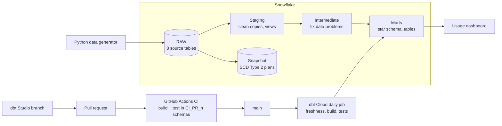

# Product usage analytics (dbt + Snowflake)

An end-to-end analytics engineering project modelled on a workflow-automation platform:
accounts, workspaces, recipes (automated workflows), recipe runs and product events.
Raw data is cleaned, modelled into a star schema, tested, monitored, and deployed
through CI to a daily production job.

**Stack:** Snowflake · dbt (Fusion engine, dbt Cloud) · GitHub Actions · Airflow · Python

## Architecture



## Layers

| Layer | Materialization | What it does |
| --- | --- | --- |
| Staging (8 models) | view | One model per source table: rename, cast, standardise. Known source problems are flagged by warn-level tests, never silently fixed. |
| Intermediate (3 models) | view | Fixes the problems: removes duplicate events, recovers missing workspaces, labels missing statuses, removes duplicate connectors. Same tests at error level. |
| Marts (6 models) | table / incremental | Star schema: `dim_accounts`, `dim_workspaces`, `dim_recipes`, `dim_date`, `fct_recipe_jobs` (one row per run), `fct_daily_workspace_usage` (one row per workspace per day). |
| Snapshot | SCD Type 2 | History of each account's plan, from a billing table that overwrites plans in place. |

Full column descriptions: [docs/data_dictionary.md](docs/data_dictionary.md), or the dbt Catalog.

## Data problems handled

| Problem in the source | Rows | Fix |
| --- | --- | --- |
| Re-delivered duplicate events | 1,599 | Keep the latest-loaded copy (`qualify row_number()`) |
| Jobs missing their workspace | 774 | Recover it from the job's recipe; flag with `is_workspace_backfilled` |
| Jobs with no status | 2,959 | Label `unknown`; counted, never treated as a success |
| Connector listed twice in one recipe | 185 | `select distinct` |
| Jobs arriving more than a day late | 3,080 | Incremental model filters on `loaded_at`, not `job_date`, with a lookback window |
| Internal employee workspaces | 1,748 jobs | Flagged in the job fact; excluded once, in the daily usage fact |

## Key design decisions

- **Incremental on load time, not event time.** `fct_recipe_jobs` merges on `job_id` and reads rows by `loaded_at` with a 3-day lookback, so late-arriving data is never skipped.
- **One default dashboard source.** `fct_daily_workspace_usage` (~43,000 rows) replaces scanning 150,000 jobs and 78,000 events, so dashboards are faster and cheaper.
- **Contracts on public models.** `dim_accounts` has an enforced contract, so renaming or dropping a column fails the build instead of breaking dashboards.
- **Separate environments.** Development (`DBT_<user>_*`), CI (`CI_PR_<n>_*`, dropped after each run) and production (`ANALYTICS_*`) never share schemas.

## Testing and monitoring

| Check | Catches | Example |
| --- | --- | --- |
| Generic tests | Wrong data | `unique`, `not_null`, `relationships`, `accepted_values` on every key |
| Singular test | Broken business rules | A job can't finish before it starts |
| Unit tests | Wrong logic | Dedup keeps the latest copy; a missing status is never a success |
| Contract | Breaking changes | `dim_accounts` column names and types |
| Source freshness | Data stopped arriving | Warn after 1 day, error after 7 |
| Volume test (custom) | Data partly missing | Daily rows dropping more than 50% vs the 7-day average |

Failing rows are stored in a `*_TEST_FAILURES` schema, and each mart names an owner and alert channel in `meta`.

## CI/CD and orchestration

- **CI** (`.github/workflows/dbt_ci.yml`): every pull request builds and tests the whole project in temporary `CI_PR_<n>_*` schemas, then drops them, even if the build fails. Merging to `main` requires CI to pass.
- **Production**: a dbt Cloud job runs daily at 01:00 UTC: source freshness, then `dbt build`, with an email on failure.
- **Airflow** (`orchestration/airflow/dags/product_usage_daily.py`): the same pipeline as a DAG. It waits for raw data with a sensor, triggers the dbt Cloud job, then checks the marts refreshed, with retries and failure alerts.

## Repository structure

```text
models/
  staging/product/      8 staging models + sources and tests
  intermediate/         3 models that fix data problems + unit tests
  marts/core/           dimensions (+ contract on dim_accounts)
  marts/products/       facts (incremental job fact, daily usage fact)
  _docs.md              reusable column descriptions (doc blocks)
snapshots/              SCD Type 2 snapshot of subscriptions
tests/                  singular test + custom generic volume test
macros/                 CI schema cleanup
orchestration/airflow/  Airflow DAG
scripts/                data dictionary generator
docs/                   generated data dictionary
.github/workflows/      CI
```

## Running it

```bash
dbt build              # build and test everything
dbt source freshness   # check sources are up to date
dbt snapshot           # capture plan changes (SCD Type 2)
python scripts/generate_data_dictionary.py   # refresh docs/data_dictionary.md
```

Built by Divya P as a portfolio project.